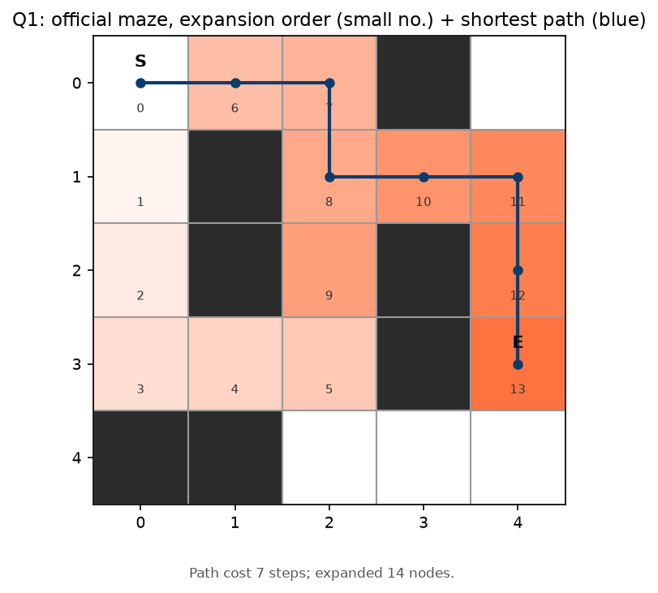
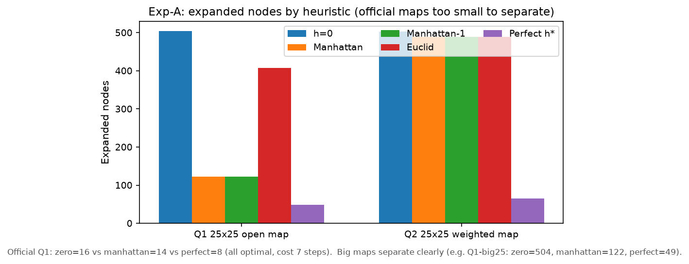
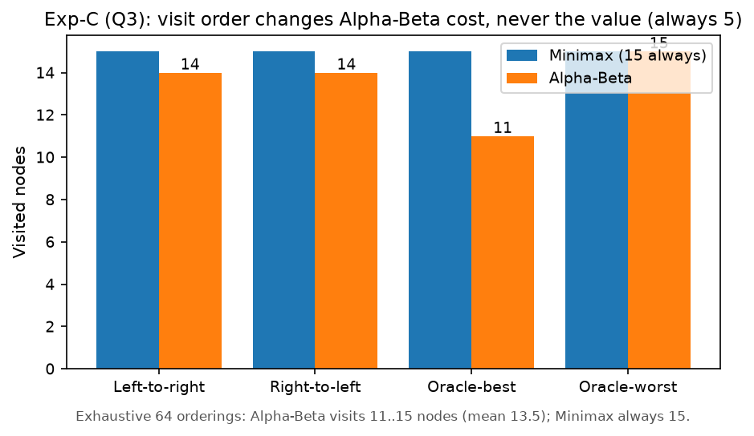
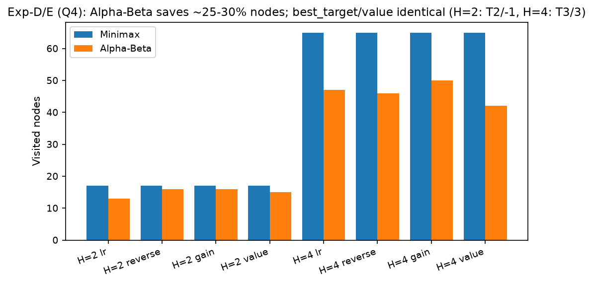

### 当代人工智能实验课：实验二报告——搜索算法

> 姓名：潘淳恺 ｜ 学号：10245501437 ｜ 日期：2026-10-29  
> 代码仓库：[https://github.com/pck-altra/Contemporary-AI.git](https://github.com/pck-altra/Contemporary-AI.git)（homework02分支）｜ 

---

#### 1. 算法设计与实验设置

**A**：结点为网格坐标，四邻接，边权取**进入目标格的代价**。维护 `f(n)=g(n)+h(n)`，每次从 `heapq` 开放表取 `f` 最小者扩展，`came` 指针回溯得路径；发现更优 `g` 则重开结点。`h` 可采纳（`h≤h`*）保证最优，一致则每结点至多扩展一次；`h≡0` 退化为 Dijkstra，作为全部对照基线。堆元素加单调 `counter` 保证可复现。

**Minimax / Alpha-Beta**：MAX 取子结点最大、MIN 取最小，自底向上回传至根，复杂度 `O(b^d)`。Alpha-Beta 沿栈传窗口 `[α,β]`（初值 `±∞`），`α≥β` 即回溯（MAX 侧为 β-cutoff，MIN 侧为 α-cutoff）。剪枝只影响速度不影响取值，故全实验用黄金断言 `Alpha-Beta == Minimax`（多顺序覆盖）护航。

**设置**：Python ≥3.10，仅依赖 `matplotlib` + `pytest`；对照实验固定种子、计时取 5 次中位数；A* 记扩展/生成数，博弈搜索记访问结点/叶/剪枝数；`experiments.py` 落盘 CSV，`make_figures.py` 生成图表，`run_all.sh` 可再生（20 测试全绿）。

---

#### 2. 题目一：迷宫寻路

起点 `(0,0)` → 终点 `(3,4)`，曼哈顿 `h`。终点出队时 `g` 最优，回溯得 `(0,0)→(0,1)→(0,2)→(1,2)→(1,3)→(1,4)→(2,4)→(3,4)`，7 步恰等于曼哈顿距离（紧下界，不可能更短），与预期逐坐标一致；无解返回 `[]`。

上图数字为出队顺序，蓝线为路径：搜索沿右侧走廊推进，`X` 墙后区域几乎未进开放表，即启发的"聚焦"效应。

| 用例 | h=0 扩展 | 曼哈顿 | 完美 h* | 代价 | 结论 |
|---|---|---|---|---|---|
| 5×5 | 16 | 14 | 8 | 7 步 | 差 2 个结点，噪声量级，分不出差异 |
| 自设 25×25 | 504 | 122 | 49 | 48 步 | 拉开 4 倍/10 倍，聚焦效应显现 |

启发函数不改变最优性（均可采纳、代价一致），只改变扩展量；欧氏在四邻接下更松（大图 408 vs 122）。tie-break（`h/g/fifo`）只改等 `f` 层次序，不改最优性。规模梯度 7→15→25→31 上 Dijkstra 扩展 44→197→514→768，曼哈顿仅 14→29→58→149，完美启发≈路径长。

---

#### 3. 题目二：加权地形

进入代价=目标格权值，**进入 `E` 为 0**。最优路径 `(0,0)→(1,0)→(2,0)→(3,0)→(3,1)→(3,2)→(4,2)→(4,3)→(4,4)`，8 步累计 `1×7+0=7`；误把 `E` 计 1 会得 8，已作回归断言。

可采纳性：设曼哈顿距离 `d(n)`、步数 `L≥d(n)`，则 `h*(n)≥(L−1)×1+0≥d(n)−1`。故普通曼哈顿 `h=d(n)` **高估≤1、非严格可采纳**（本例仍得 7 系运气）；严格版为 `max(0,d−1)`，实测同为 9 扩展/代价 7，印证"差异上界为 1"。实测：h=0 扩展 15，曼哈顿/修正版/完美均为 9；25×25 加权大图上曼哈顿 489 vs 完美 65，说明大尺度下地形权值才是主导、±1 端点修正可忽略。

---

#### 4. 题目三：Alpha-Beta 剪枝

回传：`MAX(3,5)=5，MAX(6,9)=9，MAX(1,2)=2 → MIN(5,9)=5，MIN(9,2)=2 → 根MAX=5`，两种算法均为 5。左到右评估时，左 MIN 返回 5 使根 `α=5`；右 MIN 右子 MAX 先见叶 1 得 1，`α=5≥β=1` 触发 α-cutoff，**叶 2 被跳过**（Alpha-Beta 14 结点/7 叶/2 剪枝 vs Minimax 15/8）。

| 顺序 | Minimax | Alpha-Beta（结点/叶/剪枝） | 值 |
|---|---|---|---|
| 从左到右 | 15 / 8 | 14 / 7 / 2 | 5 |
| 从右到左 | 15 / 8 | 14 / 7 / 1 | 5 |
| Oracle 最优 | 15 / 8 | **11 / 5 / 2** | 5 |
| Oracle 最差 | 15 / 8 | 15 / 8 / 0 | 5 |

穷举 64 种排列：Alpha-Beta 访问 11~15（均值 13.5），Minimax 恒 15。**顺序只影响开销不影响取值**；本树浅小、剪枝天花板有限，深树才有 `O(b^d)→O(b^(d/2))` 量级差。

---

#### 5. 题目四：宝藏分配（综合题）

**距离矩阵**（A* 两两求解，A/B/T 格代价 1；宝藏记 0 会使 H=4 得 2 而非 3，故断言校验）：A→B12/T1 10/T2 4/T3 8/T4 8；B→T1 8/T2 8/T3 4/T4 10；T1→T2 6/T3 6/T4 12；T2→T3 6/T4 6；T3→T4 6（对称，见 `results/q4_distance_matrix.csv`）。

**状态**：`(pos_A, pos_B, remaining, score_A, score_B, turn, depth)`，选 `Ti` 得 `gain=V[Ti]−d(p,Ti)`，叶评估 `U=score_A−score_B`，`depth==H` 或取完即截断。因经过不收集、已取格可通行、对手不挡路，矩阵整局恒定，搜索只查表。

| 首步 | 即时收益 | H=2 | H=4 |
|---|---|---|---|
| T1 | −1 | −4 | −5 |
| T2 | **+2** | **−1 最优** | +1 |
| T3 | −1 | −2 | **+3 最优** |
| T4 | −1 | −4 | −7 |

H=2 只看一步：仅 T2 即时 +2，B 应 T3（+3），`U=2−3=−1`，属贪心最优。H=4 最优变为即时 −1 的 T3：①**否决**——夺走 B 的 +3 目标；②**惩罚**——最优线 `A→T3(−1)→B→T1(+1)→A→T2(0)→B→T4(−5)`，B 末步被迫 T1→T4（距离 12≫价值 7），`U=−1−(1−5)=3`。即**深度不足贪心眼前、深度足够则"否决+惩罚"**，最优首步 T2→T3 迁移。

剪枝（H=4）：Minimax 65 结点/24 叶，Alpha-Beta lr 顺序 47/16（省 ~28%），`value` 排序最优 42/14，`gain` 排序反最差 50/18——`V` 与 `d` 耦合弱时单步 gain 是噪音，**排序启发只在代价与收益相关时有效**。H=2（T2/−1）与 H=6（同 H=4，因仅 4 宝）略。

---

#### 6. 自设对照与拓展

**加权 A（`w·h`）**：小图 `w=1~5` 全最优 7（太小咬不到肉）；25×25 加权大图（最优 138）上 w=1.5/2.0 仍 138（扩展 455/406），w=3.0 失守 139（193），w=5.0 偏至 165（仅 60）——典型"效率换最优性"，临界约 w=3（见 `results/exp_weighted_astar.csv`）。**完美启发**（反向 Dijkstra 预计算 `h`*）在大图扩展≈路径长（49 vs 48 步；加权图 65 vs 48 步），但预计算本身为一次 Dijkstra，小问题得不偿失。另：tie-break 为弱因素；H>4 退化（H=6 同 H=4）；全隔离图正确无解（`[]`/`−1`）；Negamax+置换表因分支≤4 无可测收益，诚实记为阴性结果。

---

#### 7. 思考与结论

1. **小图保正确、大图谈效率**：官方用例作回归哨兵，效率结论必须来自自设大图并同时给出两组数据。
2. **差 1 也要讲清**：题二曼哈顿高估≤1 被小代价掩盖但保证已丢，`max(0,d−1)` 才是严格写法。
3. **排序非万能**：题四 `gain` 排序输给固定序，说明排序增益要求信号与真值单调相关，阴性结论同样有价值。
4. **深度的价值在建模对手**：H=2→H=4 迁移证明增量来自"否决+惩罚"而非单步贪心。

四题官方预期全复现；A* 效率由启发紧致度决定（504→122→49），Alpha-Beta 由访问顺序决定（15→11、65→42），均不改最优解。全部数据图表测试可由 `bash run_all.sh` 再生。
